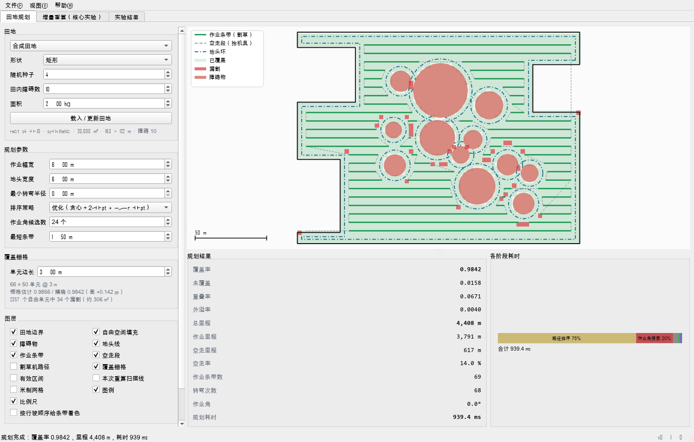
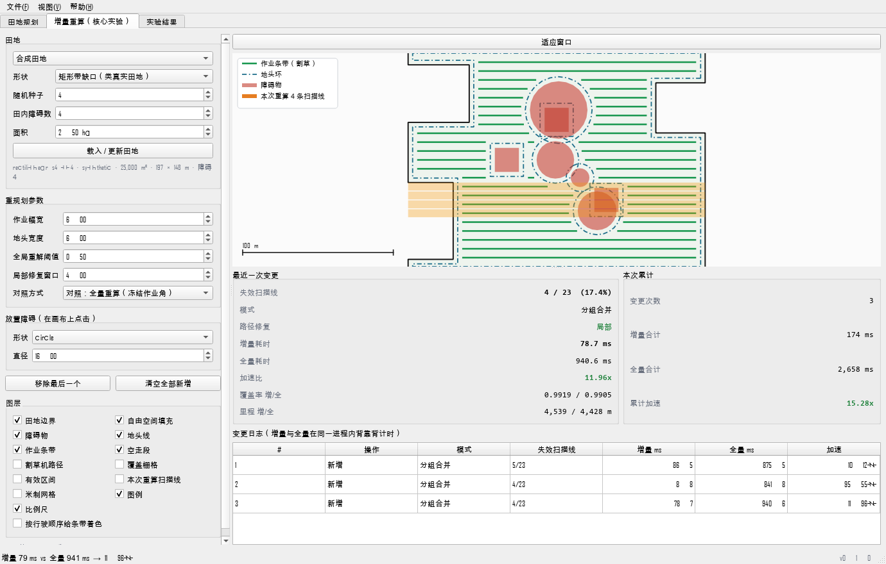

# cppclip

面向农业机械的覆盖路径规划（Coverage Path Planning, CPP）。把问题**形式化为几何裁剪**而非单元格分解，并利用由此得到的扫描线边表，在环境发生变化时**增量重算**。

核心洞察只有一句：计算机图形学里做多边形填充用的**扫描线活性边表**，原封不动就是覆盖路径规划需要的数据结构。每条作业线就是扫描线与可行驶区域的交集；而由于多边形的每条边都按其覆盖的 `y` 跨度建了索引，作业途中新出现的障碍只会让它自己跨度内的那几条扫描线失效。

```
田地 + 障碍物
      │
      ├─ 按地头宽度内缩边界 ──────────► 地头环
      │
      └─ 扫描线边表 ──► 有效区间 ──► 作业条带
                              │
                              └─ 排序 ──► 覆盖路径
```

整条流水线里**没有任何单元格分解**。凹形和孔洞由奇偶（even-odd）规则自然得出。

---

## 一、运行说明

### 1.1 环境要求

| 项目 | 要求 | 说明 |
|---|---|---|
| 操作系统 | Windows / Linux / macOS | 本项目在 Windows 11 上开发与实测 |
| Python | **3.11 及以上**（实测 3.14.5） | 依赖 `shapely>=2.0`、`numpy>=1.26` |
| Docker | 仅对比实验需要 | 用于运行 Fields2Cover 基线；不做对比则不需要 |
| PySide6 | 仅图形界面需要 | 由 `[gui]` 附加项自动安装 |

**不需要** GDAL、pyproj、CMake 或任何 C++ 工具链。真实田地数据的投影由本仓库自己用 WGS84 级数展开实现。

### 1.2 安装

```bash
cd C:\Users\666\Desktop\CPP

# 建虚拟环境（推荐，避免污染全局 Python）
python -m venv .venv

# Windows —— [gui] 会一并装上 PySide6，供图形界面使用
.venv\Scripts\python -m pip install -e ".[gui]"

# Linux / macOS
# .venv/bin/python -m pip install -e ".[gui]"
```

上面所有命令都直接用虚拟环境里的解释器路径调用，**不需要先激活 venv** —— 在仓库根目录照抄即可。去掉 `[gui]` 附加项仍然能装好库并跑全部实验，只有图形界面需要它。若你的 shell 对 `[gui]` 里的方括号不满意，加引号写成 `".[gui]"`；在 PowerShell 7 与 bash 里不加引号也能正常工作。

若 `pip` 因权限被拒，可先指定临时目录：

```powershell
$env:TEMP = "$PWD\.tmp"; $env:TMP = "$PWD\.tmp"
```

### 1.3 启动图形界面

装好 `[gui]` 之后，下面两种方式等价，任选其一：

```bash
.venv\Scripts\python -m cppclip.gui        # Windows
.venv\Scripts\cppclip-gui                  # pip 装出来的命令行入口

# Linux / macOS
# .venv/bin/python -m cppclip.gui
# .venv/bin/cppclip-gui
```

会弹出一个**桌面窗口**（不是网页、不起服务器），三个页面分别是 **田地规划**、**增量重算（核心实验）**、**实验结果**。如果什么都没出现，说明进程在启动时就退出了 —— 报错信息在你执行命令的那个终端里。

第一次用，大约两分钟可以这样走一遍：

1. **田地规划** 页 —— 田地面板里已经放好一块 2 ha 的合成田地，直接点 **规划**。应能看到：绿色作业条带、沿边界与每个障碍的蓝色点划线地头环、灰色虚线空走段，以及一层很淡的绿色覆盖栅格（漏割处为红色）。
2. 取消勾选 **覆盖栅格**，下面的作业条带立刻变得清楚；勾上 **割草机路径** 会在最上层叠加橙色的完整行驶折线。
3. **增量重算** 页 —— 在田地内任意位置点一下。该处出现一个障碍，被重新裁剪的扫描线以橙色带标出，面板同时给出「增量耗时 vs 同场景从头重算耗时」的对比（两者在同一进程内背靠背计时）。
4. **实验结果** 页 —— 下拉选一个实验，图由 `results/tables/*.csv` 实时重绘，下方是原始表格。

### 1.4 界面起不来时

| 现象 | 原因与处理 |
|---|---|
| `ModuleNotFoundError: No module named 'PySide6'` | 没装 `[gui]` 附加项。重跑 `pip install -e ".[gui]"`，注意加引号。 |
| `pip` 报 `Invalid requirement: .[gui]` 或匹配不到东西 | shell 把方括号吃掉了。加引号：`".[gui]"`。 |
| `Could not find the Qt platform plugin "windows"` | 同一个环境里装了两套 Qt 绑定（常见是 PyQt5 + PySide6）。给本项目单独用一个干净的 venv。 |
| 图表里的中文变成空方块 | 系统没有中文字体。界面会自动从 微软雅黑 / SimHei / Noto Sans CJK / PingFang 里挑一个；一个都没有时图表标签就会空着。 |
| 窗口开了但画布空白 | 先点田地面板的 **载入 / 更新田地**，再点 **规划**。 |

无显示器的机器（CI、容器）上没法弹窗：设 `QT_QPA_PLATFORM=offscreen` 后用 `tools/gui_screenshot.py`，它驱动真实控件、离屏渲染出 PNG。

### 1.5 跑测试

```bash
.venv\Scripts\python -m pytest tests/ -q      # 145 个测试，约 3 分钟
```

测试分五个文件：`test_sweep.py`（65 个，裁剪核心正确性）、`test_turns.py`（40 个，Dubins 与地头转弯）、`test_routing.py`（16 个，路径排序）、`test_incremental.py`（15 个，增量重算与全量重建逐位一致）、`test_planner.py`（9 个，地头记账与地头不进入障碍）。

### 1.6 看一个能跑的例子

```bash
.venv\Scripts\python examples\quickstart.py
```

会依次演示：裁剪核心（并与 GEOS 精确裁剪比对误差）、完整规划管线、动态增量重算（障碍出现再清除），并输出两张图到 `results/figures/`。

### 1.7 复现整套研究（**一条命令**）

```bash
.venv\Scripts\python experiments\run_all.py            # 约 50 分钟
.venv\Scripts\python experiments\run_all.py --quick    # 小样本冒烟测试，约 6 分钟
```

`run_all.py` 按报告呈现的顺序依次执行全部实验，**计时实验严格串行**——报告里的数字是单次墙钟时间，并发跑两个规划器会让这些数字失去意义。

`--quick` 会把真实结果表移到一边、跑完再恢复，因此冒烟测试**不会**覆盖报告所依赖的产物；它同时跳过数字核对（因为此时磁盘上的表本来就是小样本）。

### 1.8 分步运行

```bash
python experiments/exp_clipping.py                  # 5.1  裁剪精确性（350 田地，约 2 分钟）
python experiments/exp_incremental.py --fields 60 --changes 6   # 5.2  增量 vs 全量
python experiments/exp_scaling.py                   # 5.3  规模效应
python experiments/exp_ablation_repair.py --fields 24 --changes 5               # 5.4  消融一
python experiments/exp_ablation_repair.py --fields 20 --changes 4 \
       --fractions 0.5 --windows 4 8 12 20 --tag exp_ablation_window            # 5.4  消融二
python experiments/exp_turn_radius.py --fields 120  # 5.5  转弯运动学代价
python experiments/make_figures.py                  # 生成报告用图
```

结果表落在 `results/tables/*.csv`，图落在 `results/figures/`。

### 1.9 与 Fields2Cover 对比（需要 Docker）

Fields2Cover 在 Windows 上**装不上**——PyPI 上只有源码包（sdist），分类器只列 Linux/macOS，且构建需要 GDAL/GEOS/Eigen/Boost/TBB/OR-Tools。所以走容器：

```bash
# 一次性、幂等：构建 fields2cover:2.1.1 镜像
bash tools/setup_fields2cover.sh

# 导出两边共用的田地几何，并用相同的 2m 转弯半径规划
.venv\Scripts\python experiments\export_cppclip.py --limit 400 --min-area-ha 0.0 --turn-radius 2.0

# 在容器里跑 Fields2Cover（350 田地，约 5 分钟）
docker.exe run --rm -v "C:\Users\666\Desktop\CPP:/work" -w /work `
    fields2cover:2.1.1 python3 -u /work/tools/f2c_benchmark.py

# 用同一套打分代码比较两边
.venv\Scripts\python experiments\exp_compare.py
```

> **已知环境限制**：Docker 命令行通过 Windows 命名管道与守护进程通信，而 Python 子进程在受限沙箱下**被拒绝打开该管道**（报错 `permission denied ... npipe:////./pipe/dockerDesktopLinuxEngine`）。因此 `run_all.py` 无法在进程内完成这一步——它会识别该错误并打印上面这条可复制的手动命令。**在普通 shell 里手动执行完全正常。**

### 1.10 检查仓库自身

```bash
.venv\Scripts\python experiments/verify.py          # 16 项一致性检查
.venv\Scripts\python experiments/audit_numbers.py   # 文档里每个数字 vs 结果表
.venv\Scripts\python tools/verify_dubins.py         # Dubins 解 vs 独立数值搜索
.venv\Scripts\python tools/verify_headland.py       # 地头环不进入障碍、不跑出田外
.venv\Scripts\python tools/check_dead_code.py       # 未使用的导入与死代码
.venv\Scripts\python tools/check_imports.py         # 每个模块都能导入
.venv\Scripts\python tools/print_numbers.py         # 打印当前所有数字（重跑后刷新文档用）
```

---

## 二、代码结构

| 模块 | 职责 |
|---|---|
| `sweep.py` | **核心**。边表 + 活性边判定、逐扫描线有效区间、障碍增量插入/删除 |
| `geometry.py` | 基于 Shapely/GEOS 的多边形约定与基本操作 |
| `swaths.py` | 有效区间 → 作业条带；旋转规划坐标系；作业角搜索 |
| `routing.py` | 条带排序（牛耕基线、贪心、2-opt、Or-opt）与路径展开 |
| `planner.py` | 端到端管线，逐阶段计时 |
| `incremental.py` | **创新点**。障碍出现/移除下的动态重规划 |
| `metrics.py` | 覆盖率、重叠率、外溢率、路径长度、空走率（定义明确写死） |
| `turns.py` | Dubins 闭式解与农业地头转弯（Ω / Π / 平转弯 / 三点） |
| `fields.py` | 合成田地生成器（矩形、L 形、U 形、星形、随机障碍） |
| `io_fields.py` | 真实田地加载：WGS84 WKT → 局部米制切平面 |
| `viz.py` | 绘图 |
| `gui/` | Qt 图形界面：`python -m cppclip.gui` |

---

## 三、怎么看懂界面画出来的东西

启动方式与三个页面各自该看什么，见 1.3 节。这一节只讲**图上那些线分别是什么**，以及覆盖栅格怎么用。

界面只是一个**视图**：它不计算库没有计算的东西，也从不报告不是从库里取来的数字。报告里若干处缺陷正是靠它发现的（见 [REPORT.zh-CN.md](REPORT.zh-CN.md) 7.1 节）—— 这本身就是做它的理由。

### 3.1 七种线

一张画布上有七种线，因此每一种的外观**始终固定**，图例也重复线型而不只是给个色块：

| 元素 | 画法 |
|---|---|
| 作业条带 | 粗**绿色**实线 —— 机具放下，正在割草 |
| 空走段 | 细**灰色**虚线 —— 机具抬起，只是转移 |
| 地头环 | **蓝色**点划线，**每个环单独一条折线** |
| 障碍物 | **半透明红色**填充，不遮住背后的东西 |
| 田地边界 | **黑色**实线 |
| 割草机完整路径 | **橙色**粗线，默认关闭 |
| 覆盖栅格 | **淡绿**色块，漏割单元标**红** |

每个元素都有独立图层开关，可以一次只问一个问题：只看条带、只看地头、或只看栅格。

### 3.2 覆盖栅格

栅格回答的是路径图回答不了的问题 —— **到底哪里割了？** 它把 `metrics.evaluate` 用来算覆盖率的**同一份扫过几何**采样到网格上（`metrics.coverage_grid`）：

```python
from cppclip.metrics import coverage_grid, swept_geometry

grid = coverage_grid(field, plan, cell=3.0, swept=swept_geometry(plan))
print(grid.coverage, grid.exact_coverage, grid.missed_area())
```

默认单元边长取作业幅宽的一半 —— 这是还能看出「相邻两条作业带之间是否有缝」的最粗尺度。传入 `swept` 可复用已有的并集：并集占了绝大部分耗时（2.5 ha 田地上约 33 ms，而采样本身不到 3 ms）。

**栅格是估计值，界面里明说了这一点。** 中心采样的误差约为「被覆盖区域的周长 × 半个单元」，而且因为网格锚定在包围盒上，这个误差的**正负号会随单元边长翻转**。所以面板同时打印栅格值、精确值和两者之差，而不是暗示它们一致。要引用数字时，仍以 `metrics.evaluate` 的精确值为准。






---

## 四、两项核心论断及验证方式

### 4.1 边表精确等价于几何裁剪

每条扫描线的有效区间都与「用 GEOS 拿直线去裁剪精确自由空间多边形」的结果比对：

```
田地数             : 350
比较的扫描线       : 14,387
失配               : 0
最大绝对误差       : 2.274e-13 m
加速比（中位）     : 9.71x   （最小 4.74x，最大 32.35x）
```

零失配、机器精度级别的误差，是后续全部工作的基础；它同时为增量方案背书，因为增量路径**只是**边表的簿记。

奇偶规则只对良构的环集合精确：外壳互不相交，孔洞严格在内且互不重叠。`check_rings()` 会检出会破坏这一前提的两类缺陷（环相交；嵌套深度 > 2——那会让障碍内部的区域被读成可行驶）。

### 4.2 增量重算远快于从头重算

在任意序列的障碍插入、删除、分组合并、分组拆分之后，增量裁剪器被断言与同场景的从头构建产生**逐位一致**的区间（`tests/test_incremental.py`）。这一等价性是速度论断成立的前提。

在真实田地上、让一个 20 m 的障碍出现在按倍数放大的田块中：

| 田地规模 | 扫描线数 | 失效扫描线占比 | 相对全量重算的加速 | 路径长度代价 |
|---|---|---|---|---|
| 2.4 ha | 28 | 19.7 % | 2.9x | -0.2 % |
| 9.7 ha | 58 | 10.3 % | 16.1x | +0.2 % |
| 39 ha | 118 | 4.8 % | 18.2x | +0.2 % |
| 156 ha | 238 | 2.6 % | 34.4x | 0.0 % |

优势随田地增大而增大：固定尺寸的障碍覆盖的扫描线**条数**大致固定，而需要重新排序的路径随田地增长。在 Fields2Benchmark 的小田地上（中位 2.1 ha，约 25 条作业线），同一测量给出 4.2x 的中位加速（相对全量重算），或 2.5x（相对已冻结作业角的全量重算）。

---

## 五、与 Fields2Cover 的正面对比

`experiments/exp_compare.py` 用**同一段代码**（`metrics.score_solution`）对两个规划器打分，输入是同一份投影后的几何，因此差异不可能来自「两个库对覆盖率的定义不同」。**全部 350 块真实田地**，作业幅宽 6 m、地头 6 m，且**转弯运动学对齐**：双方最小转弯半径都是 2.0 m。中位数：

| 指标 | cppclip | Fields2Cover 2.1.1 (snake) |
|---|---|---|
| 覆盖率 | **0.9868** | 0.9847 |
| 总行驶里程 | **4016 m** | 4338 m |
| 空走率 | **8.1 %** | 16.1 % |
| 重叠率 | 3.35 % | **1.69 %** |
| 规划耗时 | **0.133 s** | 0.211 s |

里程比（cppclip / Fields2Cover）：中位 **0.937**（p10 0.834，p90 0.986）。

**对齐转弯模型是必要的**：直线连接会低估行驶里程，在 2 m 半径下低估 **1.8 %**、4 m 半径下低估 6.9 %（`experiments/exp_turn_radius.py`）。不做这项修正，里程比会读成 0.922 而非 0.937。

Fields2Cover 唯一占优的指标是**重叠率**——它用 Dubins 转弯几何，比本仓库「紧贴自由空间裁剪的条带 + 同心偏移地头环」在条带接缝处重复覆盖得更少。这是它实打实的优势。

---

## 六、数据

`data/fields2benchmark/` 存放 Fields2Benchmark 的 **350 块真实田地**（Mier 等，2025），Zenodo DOI [10.5281/zenodo.14524734](https://doi.org/10.5281/zenodo.14524734)：EPSG:4326 的纯文本 WKT，荷兰 140 块 / 立陶宛 113 块 / 爱沙尼亚 97 块，其中 49 块带有真实的内部环（即田内障碍）。

`io_fields.py` 把每块田地投影到以自身质心为中心的局部切平面（用 WGS84 级数展开算每度米数），因此无需 pyproj/GDAL 依赖。数据的来源、许可以及其他已获取的数据集见 `data/DATASETS.md`。

> **许可提醒**：Zenodo 存缴声明为 CC BY 4.0，但数据集自带的 README 记录了混合的上游条款——其中 113 块 `lt_` 田地是**仅限非商业使用**。干净的子集是 `nl_` 加 `ee_`。

---

## 七、标定过的参数

`IncrementalPlanner` 里有两个旋钮是**实测标定**出来的，不是拍脑袋定的（`experiments/exp_ablation_repair.py`）：

* `global_repair_fraction = 0.5`——插入条带数超过路径规模的这个比例时，改为全局重解路径。消融结果：0.0 时 100 % 触发全局重解、加速仅 1.03x；0.5 时 1 % 触发、加速 1.37x。
* `repair_window = 4`——扰动附近的 2-opt/Or-opt 窗口。4 给出 2.18x 加速、路径代价中位 -0.36 %；20 给出 1.38x。超过 8 之后，多花的局部搜索时间买不回质量。

---

## 八、局限性

* **转弯运动学只做了前进方向那一半。** `turns.py` 用闭式解求 Dubins，每条路径都经过验证（到达误差 5e-14 m，且不劣于任何其他可行词）。**Reeds-Shepp 刻意未实现**：48 个词里取子集得到的是**上界**而非最优的近似，一个名叫 `reeds_shepp` 却返回长 20 % 路径的函数会静默污染所有转弯代价对比。具体代价是：在 `w < 2r` 时，鱼尾式或三点掉头可能短于本模块给出的 Ω 环，因此该区间的转弯长度是上界。
* **障碍互不重叠的前提。** 奇偶快速路径只对环不相交的集合精确。膨胀后相接的障碍会被合并成分组以维持该前提；真正自重叠的输入需要先做规范化（GEOS `make_valid`）。
* **渗透效应。** 当田内障碍的间距小于两倍地头内缩量时，它们膨胀后的形状会连成一个连通分量，此后任何靠近该分量的变更都会更贵。
* **单机。** 没有多机划分，没有容量/补给约束。
* 在非凸田地上覆盖率约 0.98 而非 1.0；残差集中在轴对齐条带加同心偏移够不到的凹角。Fields2Cover 的缺口是同一量级（0.9848），属问题类性质而非某个实现的问题。

---

## 九、参考文献

核实过的文献清单（含对若干广为流传引用的更正）见 [`notes/LITERATURE.md`](notes/LITERATURE.md)（英文）。主要来源：

* Mier, G., Valente, J., & de Bruin, S. (2023). *Fields2Cover: An Open-Source Coverage Path Planning Library for Unmanned Agricultural Vehicles.* IEEE RA-L 8(4), 2166-2172. [10.1109/LRA.2023.3248439](https://doi.org/10.1109/LRA.2023.3248439)
* Mier, G., Casado Faulí, A. M., Valente, J., & de Bruin, S. (2025). *Fields2Benchmark.* Smart Agricultural Technology 12, 101156. [10.1016/j.atech.2025.101156](https://doi.org/10.1016/j.atech.2025.101156)
* Jayalakshmi, K. P., Nair, V. G., & Sathish, D. (2025). *A Comprehensive Survey on Coverage Path Planning for Mobile Robots in Dynamic Environments.* IEEE Access 13, 60158-60185. [10.1109/ACCESS.2025.3556446](https://doi.org/10.1109/ACCESS.2025.3556446)
* Choset, H. (2000). *Coverage for robotics: a survey of recent results.* Annals of Mathematics and Artificial Intelligence 31, 113-126.

---

**语言** · [English README](README.md) · [English report](REPORT.md) · 中文报告见 [`REPORT.zh-CN.md`](REPORT.zh-CN.md)
