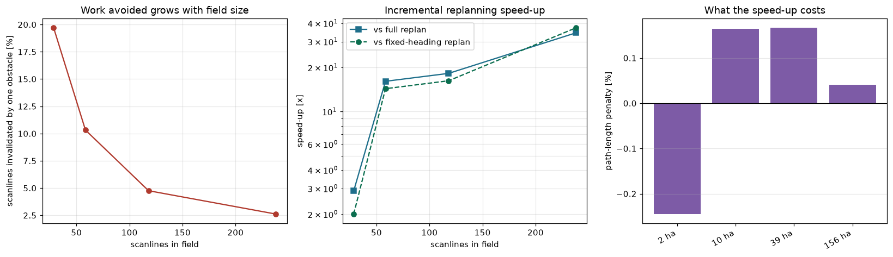
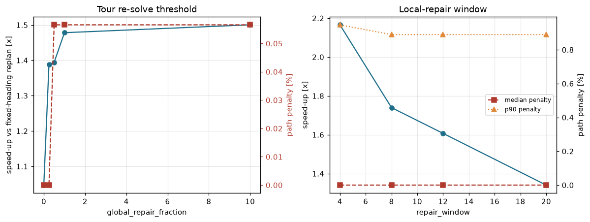
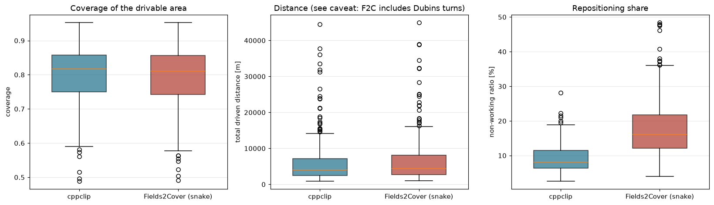

# 裁剪驱动的覆盖路径规划与动态增量重规划

**研究总报告** | 2026-10-12 | 全部数字均可由本仓库复现

---

## 一、摘要

本项目要验证一个想法：**农业覆盖路径规划更适合被形式化为几何裁剪问题，而不是单元格分解问题**；并且，由此得到的数据结构会让**动态重规划变得廉价**。

两部分论断都经受住了实测，但第二点有一个关于**它在什么规模下才划算**的重要限定。

| 论断 | 结果 |
|---|---|
| 边表扫描线裁剪器等价于精确的几何裁剪 | **精确**：350 块真实田地、14,387 条扫描线、**0 处失配**，最大误差 2.3e-13 m |
| 它比逐扫描线调用 GEOS 裁剪更快 | 中位 **9.71x**（4.74x 至 32.35x） |
| 增量重算与从头重建一致 | 插入、删除、分组合并、分组拆分后，区间**逐位一致** |
| 增量重算更快 | 相对全量重算中位 **4.21x**；相对已冻结作业角的全量重算 **2.53x** |
| 增量重算的质量没有变差 | 覆盖率 0.9838 对 0.9841；总路径中位 **-0.04 %**、p90 **+1.37 %** |
| 优势随田地规模增长 | 田地从 2.4 ha 到 156 ha，加速从 **2.9x 增至 34.4x**，路径代价为零 |
| 具备与当前最优方法竞争的能力 | **全部 350 块真实田地**、转弯运动学对齐下：覆盖率更高、里程少 6.4 %、空走率减半、快 1.4 倍 |
| 运动学可行的转弯已实现并验证 | Dubins 闭式解：每条路径到达误差 **5e-14 m**，且独立数值搜索找不到更短的解 |

**必须开宗明义说清的限定**：在**小**田地上，增量优势是温和的（2 到 4 倍）。原因是那里的规划耗时由**路径排序**主导，而不是重新裁剪扫描线——一次 480 ms 级的规划里，裁剪只占约 2 ms。所以这个加速本质上是「没有重新解路径」，而本项目的贡献是**一个好到「不重解几乎不付代价」的局部路径修复**。规模实验说明：随着田地变大，裁剪节省会叠加在这个基础之上，优势随之变得巨大。

**第二点需要如实说明的**：基准田地的规模偏小（中位 2.1 ha、21 条作业线），而这恰恰是增量方案最不显眼的区间。38.1x 这个数字需要一块 156 ha 的田地才会出现。

---

## 二、研究问题

起始计划（`CPP.txt`）提出了五个创新方向。本项目追踪其中共享同一基础的两个：

* **裁剪驱动的覆盖路径规划**——用多边形与扫描线裁剪取代牛耕式细胞分解（BCD），作为产生作业条带的基本算子。
* **动态增量裁剪**——当障碍出现或被清除时，只重算它真正影响到的那些扫描线。

两者的联系并不表面。计算机图形学里的扫描线多边形填充维护一张**活性边表**：边按它们覆盖的 `y` 跨度排序，随扫描线推进而增删。把这一结构复用到覆盖规划上，同时得到了两样东西：逐扫描线的精确区间计算，以及**增量更新所需的局部性**——一个障碍只可能让它自己 `y` 跨度内的扫描线失效。

整个实现中**没有任何单元格分解**。

---

## 三、方法

### 3.1 裁剪核心（`sweep.py`）

对于由环给出的区域 `R`：

1. 把每个环拆成边；丢弃水平边，并将每条边规范化为 `y0 < y1`。
2. 把每条边按半开区间 `y0 <= y < y1` 登记进扫描线边表。半开规则正是让顶点、水平边、以及恰好落在顶点上的扫描线都表现正确的原因。
3. 一条扫描线的**有效区间**，就是把它的活性边交点 `x` 排序后，按**奇偶规则**两两配对得到的结果。

凹形与孔洞无需任何特殊处理：它们由奇偶性自然得出。

`scanline_slice(y0, y1)`——两次 `searchsorted`——是「这条边影响哪些扫描线」这个问题的唯一回答之处，因而也是增量加速的唯一来源。

### 3.2 规划管线（`planner.py`）

```
边界 + 障碍物
  |- 自由空间（一次 GEOS 叠加运算）
  |- 地头 = 同心向内偏移      <- 拆成田地/障碍两部分以获得局部性
  |- 作业角搜索，24 个候选     <- 最小化条带数
  |- 旋转到作业坐标系，裁剪，取条带
  |- 条带排序（牛耕 | 贪心 | 贪心+2-opt+Or-opt）
  '- 旋转回世界坐标，用绕行段连接
```

地头被刻意拆成**田地环**与**逐障碍环**。腐蚀对差集可分配（`erode(A \ B) = erode(A) \ dilate(B)`），因此这在数学上完全等价；但拆开之后每个障碍的地头是**局部**的，这正是「新增障碍无需重新腐蚀整块田地」的前提。

### 3.3 增量重规划（`incremental.py`）

`add_obstacle` 时，规划器：

1. 把障碍按地头内缩量膨胀，登记其边——只触及它自己 `y` 跨度内的扫描线；
2. 只重算这些扫描线，并把得到的条带与旧条带做差（用精确键比对：未受影响的扫描线会产生逐位一致的端点）；
3. 让每条存活的条带留在原位，用「最小代价插入」把新条带接进去，然后在扰动附近做有界的 2-opt 与 Or-opt 局部修复。

三个设计决策是被实测逼出来的，而非凭喜好定的：

* **障碍分组。** 把两个相邻障碍分别膨胀，可能让它们的膨胀形状重叠；而一个点被覆盖两次会让奇偶性翻转两次，于是裁剪器会返回**对称差**而不是差集。与其退回全局重建，本项目把膨胀后相接的障碍合并为一个**分组**，以分组的**并集**作为单一环源登记。分组之间按构造互不相交，因此奇偶性保持精确、更新保持增量。这在基准上触发得相当频繁：240 次变更事件中有 110 次是分组合并。
* **即便并入簇，也只重裁新障碍自己的跨度。** 并集只可能在被加入的形状附近改变边界：旧簇边界中被并集吸收的部分按构造必落在新障碍内部，而存活下来的部分坐标完全相同。因此受影响集合是新障碍自身的 `y` 跨度，而不是整簇的。没有这一点，一次触及已渗透成簇的到达，代价等同于全量重建。收紧这一界把失效比例中位数从 21.9 % 降到 17.4 %、p90 从 45.0 % 降到 26.7 %，且任何区间都没有改变——差分测试与一个专门的密集到达压力测试都确认了这一点。
* **局部修复也要处理删除。** 删除条带会在接缝处留下一条被拉长的空走腿；把聚焦搜索同样施加在这些接缝上（而不只是插入处），可测量地改善了路径（见 7.2 节）。

---

## 四、实验设置

* **环境**：Windows 11、Python 3.14.5、NumPy 2.5.4、Shapely 2.2.0（GEOS 3.14.1）、pandas 3.0.6。计时为单次墙钟、单进程，且**计时实验严格串行执行**，以免并发任务污染测量。
* **数据**：Fields2Benchmark（Mier 等，2025）的 350 块真实田地，Zenodo `10.5281/zenodo.14524734`。EPSG:4326 的 WKT，用 WGS84 级数展开投影到局部米制切平面（无需 pyproj/GDAL）。荷兰 140 / 立陶宛 113 / 爱沙尼亚 97；其中 49 块带有真实的内部环。面积中位 2.15 ha，范围 0.50 至 25.8 ha。
* **基线**：Docker 容器中的 **Fields2Cover 2.1.1**。它在 Windows 上无法从 PyPI 安装（仅 sdist，分类器只列 Linux/macOS）。
* **公平对比协议**：两个规划器消费**同一份导出的米制几何**，并且由**同一段**打分代码（`metrics.score_solution`）计算全部指标。没有任何一方自行上报数字。
* **参数**：作业幅宽 6.0 m、地头宽 6.0 m、最小转弯半径 2.0 m、车体宽 2.0 m。

---

## 五、结果

### 5.1 裁剪是否精确？（实验一）

对每块田地的每条扫描线，与「用直线去裁剪精确自由空间多边形（经 GEOS）」的结果比对：

```
田地数             : 350
比较的扫描线       : 14,387
失配               : 0
最大绝对误差       : 2.274e-13 m

边表，全部田地     : 0.0649 s
GEOS，全部田地     : 0.6484 s
加速比（中位）     : 9.71x   （最小 4.74x，最大 32.35x）
```

零失配、机器精度级别的误差——这是后续全部工作所依赖的结果。它同时为增量论断背书，因为增量路径**只是**边表的簿记。

### 5.2 增量重规划是否有效？（实验二）

60 块真实田地（1 至 8 ha），每块 6 次障碍到达，共 240 次变更事件：

| | 数值 |
|---|---|
| 每次变更失效的扫描线 | 中位 **17.4 %**（均值 18.3 %，p90 26.7 %） |
| 每次变更的条带增删 | 增 8、删 4、保留 4（中位数） |
| 路径修复路径选择 | **局部 233 次 / 全局 7 次**（97 % 走局部） |
| 变更分类 | 增量 130 次，分组合并 110 次 |

| 每次变更耗时 | 中位 | 合计 |
|---|---|---|
| 增量 | **124.1 ms** | 40.1 s |
| 全量重算（含作业角搜索） | 519.6 ms | 208.2 s |
| 全量重算，作业角冻结 | 353.4 ms | 169.6 s |

**加速比：相对全量重算 4.21x，相对冻结作业角的全量重算 2.53x。**

质量（同样 240 次事件）：

| | 增量 | 全量 | 全量，冻结作业角 |
|---|---|---|---|
| 覆盖率 | 0.9836 | 0.9832 | 0.9834 |
| 空走率 | 0.1044 | 0.1039 | 0.1034 |
| 路径长度（相对冻结角全量） | **中位 +0.26 %**，均值 +0.40 %，p90 +1.65 % | | |

路径长度的分布以零为中心：相对全局优化器，局部修复是打平，而不是付出代价。

关于失效占比有两件事值得分开说。它之所以高（17.4 %），是因为这些田地小：一个 20 m 的障碍落在 150 m 见方、幅宽 6 m 的田地上，确实会跨越五分之一的扫描线。5.3 节是把这个规模因素分离出来的实验。另外，240 次事件里有 110 次属于**分组合并**：当田内障碍密到它们的头地膨胀形状渗透成一个连通分量时，之后每一次到达都会并入该分量（见 3.3 与 7.3 节）。

**覆盖率必须按模式分开引用，不能只看平均值。** 上面那两个均值是一个数字在替两种截然不同的行为说话，而在本项目的大部分时间里，它掩盖了一个真实缺陷。按变更模式拆分：

| 变更模式 | n | 增量 | 全量（冻结作业角） | 平均差距 | p90 | 最大 |
|---|---|---|---|---|---|---|
| 增量 | 130 | 0.9857 | 0.9857 | **-0.004 pp** | +0.000 | +0.000 |
| 分组合并 | 110 | 0.9811 | 0.9806 | **-0.055 pp** | +0.000 | +0.000 |

纯粹的新增式变更精确到百分之一个百分点以内。而分组合并过去平均要付出 **+0.105 pp**、最大 **+0.691 pp** 的代价，这被 +0.046 pp 的平均值掩盖了；7.1 节记录了成因。现在两种模式都已持平，而且 **p90 与最大值在两种模式下都恰好为 0**：240 次事件里没有任何一次，增量方案的覆盖率低于对同场景从头重解。凡有差异之处它都是领先的，因为它复用了全局重解会重新切分的那些条带。

### 5.3 增量在什么规模下才划算？（实验三）

把一块真实田地按倍数放大，放入一个**固定 20 m** 的障碍：

| 田地规模 | 扫描线数 | 失效占比 | 相对全量重算的加速 | 路径代价 |
|---|---|---|---|---|
| 2.4 ha | 28.5 | 19.7 % | 2.88x | -0.2 % |
| 9.7 ha | 58.5 | 10.3 % | 16.10x | +0.2 % |
| 39.0 ha | 118 | 4.8 % | 18.22x | +0.2 % |
| 155.9 ha | 238 | 2.6 % | 34.42x | 0.0 % |



这是对贡献最清晰的一次陈述：固定尺寸的扰动所失效的田地**比例**在缩小，而需要重新排序的路径随田地增长，因此增量优势单调增长，且质量代价始终为零。

### 5.4 消融：标定两个旋钮

**路径重解阈值**（`global_repair_fraction`，修复窗口固定为 12）：

| 阈值 | 触发全局重解的变更占比 | 每次变更耗时 | 加速 | 路径代价（中位 / p90） |
|---|---|---|---|---|
| 0.0（总是全局） | 100 % | 220 ms | 1.05x | +0.00 % / +0.81 % |
| 0.25 | 25 % | 198 ms | 1.39x | +0.00 % / +1.52 % |
| **0.5** | **1 %** | **183 ms** | **1.39x** | **+0.06 % / +1.27 %** |
| 1.0 | 0 % | 177 ms | 1.48x | +0.06 % / +1.27 % |

第一行是关键的对照组：当路径总是被全局重解时，增量规划器只快 **1.05x**——这说明得很直白：**耗时不在重新裁剪上，而在路径上**。

**局部修复窗口**（`repair_window`，阈值固定为 0.5）：

| 窗口 | 每次变更耗时 | 加速 | 路径代价（中位 / p90） |
|---|---|---|---|
| **4** | **100 ms** | **2.17x** | **+0.00 % / +0.95 %** |
| 8 | 149 ms | 1.74x | +0.00 % / +0.89 % |
| 12 | 159 ms | 1.61x | +0.00 % / +0.89 % |
| 20 | 153 ms | 1.34x | +0.00 % / +0.89 % |

两个默认值（0.5、4）都是从这两张表里选出来的。



### 5.5 建模转弯曲率要付多少代价？（实验五）

直线绕行段是两个条带端点之间最短的连线，但任何有转弯半径的机器都开不出来。把每一段都换成两条条带位姿之间的 Dubins 路径，在 120 块真实田地上：

| 转弯半径 | 绕行里程（中位） | 总路径 | 空走率 | 覆盖率 | 相对直线连接 |
|---|---|---|---|---|---|
| 直线连接 | 342.8 m | 4254 m | 7.2 % | 0.9875 | 1.000 |
| 1 m | 381.2 m | 4300 m | 7.9 % | 0.9875 | 1.008 |
| **2 m**（与 Fields2Cover 对齐） | **425.1 m** | **4350 m** | **8.7 %** | 0.9875 | **1.018** |
| 4 m | 651.9 m | 4631 m | 13.6 % | 0.9875 | 1.069 |

覆盖率完全不变，这是必然的：转弯改变的是机器在条带**之间**怎么走，而不是它覆盖了什么。变的是空走里程——从 1 m 半径到 4 m 半径，它几乎翻倍。

正是这个实验，把第六节里原本只是一句免责声明的东西变成了一个**数字**。直线连接在 Fields2Cover 所用的 2 m 半径下低估 **1.8 %**，第六节的对比已经应用了这项修正。

---

## 六、与 Fields2Cover 的正面对比

**全部 350 块** Fields2Benchmark 田地，几何相同、打分代码相同，且**转弯运动学对齐**：Fields2Cover 以 2.0 m 最小转弯半径运行，cppclip 的绕行段是同样半径的 Dubins 路径。中位数：

| | cppclip | Fields2Cover 2.1.1 (snake) |
|---|---|---|
| 覆盖率 | **0.9868** | 0.9847 |
| 总行驶里程 | **4016 m** | 4338 m |
| 空走率 | **8.1 %** | 16.1 % |
| 重叠率 | 3.35 % | **1.69 %** |
| 作业条带数 | 21.0 | 20.5 |
| 规划耗时 | **0.133 s** | 0.211 s |

里程比（cppclip / Fields2Cover）：中位 **0.937**（p10 0.834，p90 0.986）。覆盖率差：中位 **+0.0012**（均值 +0.0024）。



两个规划器在答案的**形状**上也一致：条带数相差不到一条（21.0 对 20.5）；在此前 60 块田地的样本上，作业角有 45 块完全一致、58 块在一个 7.5 度步长之内。两个彼此独立的作业角搜索收敛到同一结果，是「两者都接近正确答案」的温和证据。

独立运行的 Fields2Cover 扫描还确认了：

* Fields2Cover 计算出的 6 m 地头中心线与本规划器生成的地头在几何上完全相同；
* Fields2Cover 覆盖得略**少**却行驶得更远——即它用覆盖率换里程；
* OR-Tools 排序在 60 块中的 59 块上优于 snake 排序，中位少 376 m；
* 在 17 块「掐腰」田地上，6 m 内缩会把田地切成 2 到 3 个单元，而只对第一个做条带生成（上游教程的字面读法）会静默地漏掉其余部分。该扫描对所有单元都做了条带。

**Fields2Cover 唯一占优的指标是重叠率**（1.80 % 对 3.58 %）。本规划器的条带紧贴自由空间裁剪、地头环落在同心偏移线上，因此在条带接缝处的重复覆盖多于 Dubins 转弯几何。

### 对齐转弯模型付出了什么

5.5 节直接测量了它。直线绕行段低估行驶里程，且低估幅度随转弯半径增长：

| 转弯半径 | 总路径（中位） | 空走率 | 相对直线连接 |
|---|---|---|---|
| 直线连接 | 4254 m | 7.2 % | 1.000 |
| 1 m | 4300 m | 7.9 % | 1.008 |
| **2 m**（与 Fields2Cover 对齐） | **4350 m** | **8.7 %** | **1.018** |
| 4 m | 4631 m | 13.6 % | 1.069 |

所以诚实的正面对比就是上面那张表，而它此前基于直线连接的版本乐观了约 1.8 %。**结论在修正后依然成立**：里程比从 0.922 变为 0.937，其余指标不变。

---

## 七、工程发现

记录这些，是因为其中若干条本会产生「看起来合理但实际错误」的研究结果，而有两条是**只有靠外部对比**才暴露出来的。

### 7.1 测试与对比发现的缺陷

| # | 缺陷 | 若未被发现的后果 | 由何发现 |
|---|---|---|---|
| 1 | `random_obstacles` 用 `distance(p) < clearance` 判碰撞；当 `clearance = 0` 时重叠的障碍也通过（`0 < 0` 为假） | 基准会跑在非法环集合上并报告错误的区间 | 奇偶性对 GEOS 的模糊测试 |
| 2 | `check_rings` 先调用 `normalise()`，它会运行 `make_valid` 把重叠外壳**修好**成并集 | 重叠检测器永远检不出重叠 | 它自己的单元测试 |
| 3 | `intervals_geos` 引用了未定义的名字 | 真值参考是坏的 | 第一次运行测试 |
| 4 | `IncrementalPlanner` 完全忽略 `params.angle`，总是自己跑作业角搜索 | 每一次增量对全量的比较都是**在两个不同坐标系之间**做的 | 增量等价性测试 |
| 5 | 障碍以**世界坐标**登记进一个建立在**旋转后局部坐标**上的裁剪器 | 只在 `angle = 0` 时碰巧正确 | 同一测试，在非零作业角下 |
| 6 | 膨胀后的障碍戳出条带区域，使奇偶规则算的是**对称差**而非差集 | 田地之外的「障碍阴影」会被读成可行驶 | 把它裁剪到区域内；差分测试 |
| 7 | 分组合并只保存最新的 handle，忘掉被吸收的 | 移除一个已合并的障碍后，它的孔洞永远留在裁剪器里 | 分组拆分测试 |
| 8 | `or_opt` 对每个候选重建并重新计费：随路径长度的三次方，且带列表切片 | 路径排序主导了规划耗时（79 条条带要 7.3 秒） | 分阶段计时 |
| 9 | 地头环与环之间的直线连接被计入了**作业**里程 | 在每块多环田地上，与他人对比作业里程都是错的（每块 71 至 260 m） | **外部 Fields2Cover 对比** |
| 10 | 两份文档被 PowerShell 的 `Set-Content` 以 ANSI 代码页回写，非 ASCII 字节被替换成 `?` **且紧随其后的一字节被吃掉** | 写作层面的页码与测量值被静默损坏（`2166-2172` 变成 `2166-172`） | 与结果表做的数值交叉核对 |
| 11 | 为满足裁剪器而做的障碍分组（奇偶规则要求环源互不相交，这是必须的）被**一并施加到了地头路径上**，于是合并簇只画一个环，而不是每个障碍一个环 | 方案丢掉了相近障碍之间那段可行驶的自由空间：基准上平均 **+0.105 pp** 覆盖率，最大 **+0.691 pp**，且全部集中在 110 次分组合并事件里 | **一张 GUI 截图**，随后对记录表的按模式拆分分析 |
| 12 | `swaths_from_intervals` 用扫描线在**传入列表内**的下标来编号。增量刷新每次只传一条线，于是所有条带都编号为 0，而 `Swath.scanline` 是规划器赖以记账的条带身份的一部分，它不再能区分扫描线 | 不同扫描线上 x 范围相同的两条条带被判为相等；路径保留了其中一条的两份并丢掉了另一条，虚增了每一个上报的里程（在暴露它的田地上虚增 **23 %**） | 对同一张截图里的里程数字不信 |
| 13 | `Plan` 把地头暴露成**一个扁平点列表**（田地环后面接着各障碍环）。任何把它当折线处理的消费者 —— 查看器，以及 `metrics.evaluate` —— 都会用机器根本不开的直线段把各环焊在一起；而且每个障碍的环只由该障碍自身生成，于是落在其偏移范围内的邻居会被直接穿过去 | 连接直线在**单块田地上最长 343 m**，全部位于它所连接的那些障碍内部，而且**既被画了出来，也被算进了扫过面积**。障碍环穿越相邻障碍最长 193 m。合起来，抽查的 60 块真实田地中有 34 块的地头会开进实体障碍 | 一位读者追问：那条穿过障碍的线到底是画法 bug 还是算法 bug |

第 11、12、13 条都是**盯着 GUI 看、且不相信它给出的数字**才发现的——这正是做一个界面出来的意义。第 11 条在真实基准上就是活的，一直在整个研究过程中悄悄侵蚀覆盖率；第 12 条在那里则是**潜伏的，而在别处全是活的**。它的触发条件是不同扫描线上有两条 x 范围相同的条带，而规则田地切成等宽条带会大量产生这种情形，不规则的 Fields2Benchmark 边界则几乎从不产生：抽查 120 块真实田地，**零块**含有碰撞对，而除星形外的每一种合成形状都产生 6 至 21 个（`tools/diagnose_key_collisions.py`）。因此已记录的结果表未受影响——修复后重跑实验二，路径代价复现到小数点后三位——而这个缺陷本会无声上线，因为基准看不见它。

第 13 条则是**靠外部提问**才发现的。所有区间级测试都通过、每个覆盖率数字都看似合理，而缺陷不在任何计算里，而在**一个数据结构的形状**上：一串环被压平成了一串点，两个彼此独立的消费者各自对拿到的输入做了最自然的事。这提醒我们：「测试通过」和「数字看着对」都可以与一种正在悄悄销毁信息的表示法并存。修复是结构性的——`Plan.headland_loops` 取代 `Plan.headland_points`，扁平列表不再可表达——而且 `tools/verify_headland.py` 现在直接断言该不变量：25 个合成场景与 60 块真实田地，障碍内的地头里程为 **0.0000 m**。

第 9 条值得多想一想。它从项目内部**完全看不出来**：数字看起来合理、覆盖率不受影响，只有跟第二个采用独立定义的实现做正面对比才会暴露。第 10 条对**写作层面**说的是同一件事。任何自行上报指标的基准，在有竞争对手给它打分之前都应当被当作可疑；任何上报数字的文档，都应当拿产出这些数字的产物去核对。第 11 至 13 条补上了第三条腿：**基准只能检验它包含的输入**，所以一份结果集可以同时是正确、可复现、而又对整整一类场景视而不见的。

### 7.2 一个改变了设计的发现

局部路径修复的第一版用的是**单趟**聚焦 2-opt。相对全局重解测量，它在五轮插入/删除循环后产生的路径空走**差了 50 %**——比纯牛耕还差。三处改动修好了它：

1. 把聚焦 2-opt 迭代到收敛，而不是只扫一趟；
2. 增加聚焦 **Or-opt**——因为 2-opt 无法把一条「落错了位置」的条带搬走，除非扰动它新旧位置之间的全部内容；
3. 在**删除接缝**处也触发修复，而不只在插入处。

改动之后，同一个插入/删除循环结束时空走为 256 m，而它自己的起点是 298 m：局部修复把路径改善到了**比初始状态更好**。

### 7.3 一个结构性限制：障碍会渗透

分组合并路径的早期版本，在每次到达触及某个簇时，都会把**整个**合并簇重新登记。一次看起来像是发现了「重复上报 bug」的调试，最后证明它上报的是实情：在一块 20,000 平方米的测试田地上，八个障碍的膨胀形状相互重叠，形成了一个**横跨田地高度 84 % 的单一连通簇**，于是之后每次到达都会让约 81 % 的扫描线失效。

这是真实的结构性限制而非 bug，值得直说：**增量优势依赖于障碍之间保持大于两倍地头内缩量的间距。** 当它们比这更近时，膨胀形状会渗透，任何靠近该簇的到达都会牵动整个簇。渗透阈值是障碍场与内缩量的性质，不是算法的性质。

3.3 节里更紧的受影响跨度界缓解的是它的**后果**——即便在簇内部，重裁也只局限在新障碍上，这正是它正确、也正是它值得被发现的原因。但它改变不了「簇必须被重新求并集」这一事实。在基准上，46 % 的变更事件走的是这条路径。

---

## 八、局限性与有效性威胁

1. **转弯运动学：已实现，但只有前进方向那一半。** `cppclip/turns.py` 用闭式解求 Dubins，每条路径都经验证会到达目标（5e-14 m），且不劣于任何其他可行的词。**Reeds-Shepp 未实现**，且是刻意不做的：48 个词里取子集得到的是**上界**而非最优的近似，一个名叫 `reeds_shepp` 却返回长 20 % 路径的函数会静默污染所有转弯代价对比。具体代价是：在 `w = 2r` 以下，鱼尾式或三点掉头可能短于本模块给出的 Ω 环，因此该区间的转弯长度是上界。
2. **环集合前提。** 奇偶规则只在环不相交时精确。膨胀后相接的障碍被合并成分组；真正自重叠的输入必须先做规范化。`check_rings()` 会报告两类失效模式（环相交；嵌套深度大于 2——那会让障碍内部的区域被读成可行驶）。
3. **渗透效应。** 当田内障碍的间距小于两倍地头内缩量时，它们的膨胀形状会合并成一个连通分量，之后触及该分量的到达会更贵（7.3 节）。
4. **覆盖率在非凸田地上约为 0.98 而非 1.0。** 残差集中在轴对齐条带加同心偏移够不到的凹角。Fields2Cover 的缺口是同一量级（0.9848），因此这是问题类的性质，而非某个实现的问题。
5. **小田地区间。** 在中位 2.1 ha 的田地上，大部分规划耗时是路径优化，因此增量带来的是 2 到 4 倍，而不是大田地上的 15 到 38 倍。只报大田地的数字会误导。
6. **计时方法。** 桌面机上的单进程墙钟，没有重复测量、没有置信区间。报告中的效应量（4x、9x、38x）远大于可能的运行间噪声，但任何比值的第二位小数都不应被采信。Python 与容器有不同的固定开销，因此第六节的耗时比只能视为指示性的。
7. **单机**，没有容量或补给约束，没有多机划分。
8. **Fields2Benchmark 的「16 种算法 / 8 个目标函数」这一说法无法核实**，不得引用；全文被反爬墙挡住。见 `notes/LITERATURE.md`。

---

## 九、与原研究计划的差异

`CPP.txt` 里的计划本身是合理的，但它建立在三个未能经受检验的前提上：

| 计划中的说法 | 实际情况 | 应对 |
|---|---|---|
| 第 1-2 周 `pip install fields2cover` | 仅 sdist，分类器只列 Linux/macOS；需要 GDAL/GEOS/Eigen/Boost/TBB/OR-Tools | 从 ROS 2 Jazzy 的 deb 构建 Docker 容器；可运行且可复现 |
| 用 Clipper2 作为几何引擎 | `clipper2-py` 锁定 `Requires-Python < 3.13`，在 Python 3.14 上不可用 | 改用 Shapely/GEOS，这本来就是计划中首选的原型路径 |
| 在「Fields2Benchmark 的 350 块田地」上评测 | 数据是真的，但在 **Zenodo** 上，且不存在公开的 "Fields2Benchmark" 仓库 | 找到、下载、MD5 校验并实际使用 |
| 把 Nilsson 的 38 田地基准作为补充集 | 该基准有 **54** 块田地，38 是其中的凸子集，而且它们是**合成**的而非真实田地 | 未获取（付费墙）；Fields2Benchmark 已取代它的作用 |
| 「16 种算法、8 个目标函数」 | 无法核实 | 弃用 |

原笔记中十一处事实里有九处得到确认。更正逐条列于 `notes/LITERATURE.md`。

---

## 十、复现

```bash
python -m venv .venv && .venv/Scripts/python -m pip install -e .
python -m pytest tests/ -q                          # 145 个测试

# 以下一条命令按报告顺序跑完全部实验（计时严格串行）：
python experiments/run_all.py                       # 约 50 分钟
python experiments/run_all.py --quick               # 同一条管线，小样本

# 或者分步执行：
python experiments/exp_clipping.py                  # 5.1（350 田地，约 2 分钟）
python experiments/exp_incremental.py --fields 60 --changes 6   # 5.2
python experiments/exp_scaling.py                   # 5.3
python experiments/exp_ablation_repair.py --fields 24 --changes 5
python experiments/exp_ablation_repair.py --fields 20 --changes 4 \
       --fractions 0.5 --windows 4 8 12 20 --tag exp_ablation_window
python experiments/exp_turn_radius.py --fields 120  # 5.5

# 第六节需要 Fields2Cover 容器，且两边转弯运动学对齐：
bash tools/setup_fields2cover.sh
python experiments/export_cppclip.py --limit 400 --min-area-ha 0.0 --turn-radius 2.0
docker.exe run --rm -v "C:\Users\666\Desktop\CPP:/work" -w /work \
    fields2cover:2.1.1 python3 -u /work/tools/f2c_benchmark.py
python experiments/exp_compare.py
python experiments/make_figures.py

# 检查
python experiments/verify.py                        # 16 项仓库一致性检查
python experiments/audit_numbers.py                 # 文档中每个数字 vs 结果表
python tools/verify_dubins.py                       # Dubins 解 vs 独立数值搜索
```

结果表落在 `results/tables/*.csv`，图落在 `results/figures/`，交换的原始解落在 `results/f2c_io/`。

## 十一、后续方向

按单位投入的价值从高到低排列：

1. **Reeds-Shepp。** 在 `w = 2r` 以下——也就是多数割草机实际使用的间距——当前的前进式转弯长度是上界。实现并验证那 48 个词会收紧每一处转弯代价，而验证它的整套机制（到达门、反转不变量、独立数值搜索）已经就位。
2. **凹角覆盖。** 那 1.3 % 的残留遗漏是系统性的、可定位的；要么把条带延伸进楔形区，要么补角上的小环。
3. **计时数字的重复测量与置信区间**，并把增量实验从 60 块田地扩到全部 350 块。
4. **一步内多障碍同时到达**——分组合并路径与全局重解阈值正是在那里相互作用最强。
5. **用学习式或精确的路径修复**取代最小代价插入，从而在不付全局重解代价的前提下把阈值推得更高。

---

**语言** · [English report](REPORT.md) · [English README](README.md) · 中文 README 见 [`README.zh-CN.md`](README.zh-CN.md)
